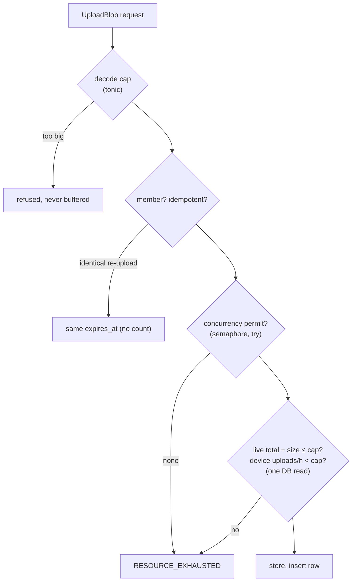

## Context

Limits today: 2 MiB per blob (`MAX_BLOB_BYTES`), 64 KiB per chat ciphertext,
256 KiB per handshake envelope, blobs expire after 7 days, only group members
upload. Missing: a total, a rate, a concurrency bound, an explicit decode cap, and
any memory ceiling on the unit (checked 2026-11-20).

## Decisions

### D1: The numbers are policy defaults, kept in `protocol/`

| Limit | Default | Why |
|---|---|---|
| `MAX_BLOB_STORE_BYTES` | 1 GiB | ~500 full-size images; a family group sends far fewer in 7 days |
| `MAX_UPLOADS_PER_DEVICE_PER_HOUR` | 60 | above any human use, below abuse |
| `MAX_CONCURRENT_UPLOADS` | 8 | 8 × ~2 MiB buffered = ~16 MiB |
| decode cap, `Blobs` | `MAX_BLOB_BYTES` + 1 KiB | the request wrapper (ids) |
| decode cap, other services | 1 MiB | largest request is a 256 KiB envelope |
| `MemoryHigh` / `MemoryMax` / `TasksMax` | 384M / 512M / 256 | the server idles in tens of MiB |

They are constants in `protocol/` (limits are defined once there), not config.
Changing one is a one-line edit and a deploy. The owner decides the values.

### D2: Where each limit is enforced

The two database checks run in the same closure as the membership and duplicate
check, so no extra round trip. The permit is held until the response is built.
The total counts only unexpired rows (`expires_at > now`), so expiry frees room
without waiting for the sweep.

### D3: The core already retries it

`client/src/engine/uploads.rs` `classify` treats every status other than
`PERMISSION_DENIED`, `INVALID_ARGUMENT`, `ALREADY_EXISTS`, `NOT_FOUND` as retry, so
`RESOURCE_EXHAUSTED` leaves the message waiting, not failed. No client change.

## Risks / Trade-offs

- [A full store holds back every member's pictures until blobs expire] → 1 GiB is
  far above normal use; the cap is a safety net. Raising it is one constant.
- [`MemoryMax` kills the server if it ever exceeds 512 MiB] → systemd restarts it
  (`Restart=always`); better than the host swapping to death. Idle use is tens of MiB.

## Migration Plan

Deploy with the next server build; no data change. Rollback: `--rollback` swaps the
binary; the unit file is re-rendered by the next deploy.

## Open Questions

None.
