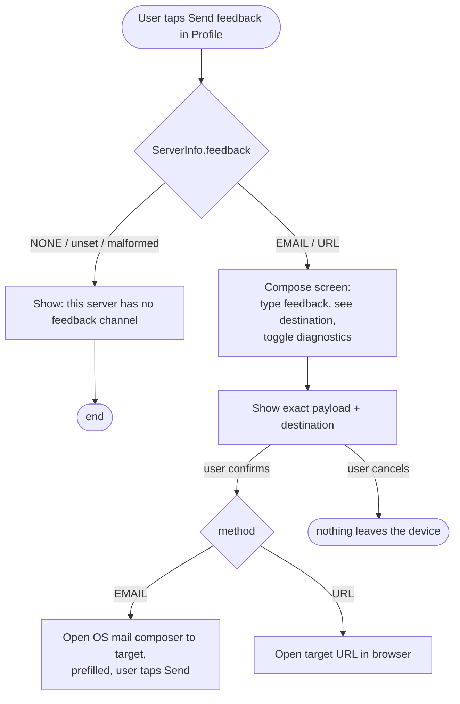

## Context

The app is published once and self-hosted by many operators (self-hostable:
Published build is operator-agnostic). There is therefore **no central inbox**:
no Anthropic address, no owner address, no publisher backend. A user on operator
X's server who wants to report "my notifications are flaky" must reach operator X,
whoever that is, through whatever channel X chose. Two further constraints shape
the design:

- **E2EE + no durable server content.** The server routes and queues but never
  stores readable message content or history (hard invariant). Any design that
  parks user-written feedback text on the server, readable, works against that
  invariant.
- **Privacy, no silent exfiltration.** The owner's email is private and must never
  be compiled into the build; and whatever the app sends on the user's behalf, the
  user must see the destination and the exact payload first, with no hidden PII
  (contacts, keys, message content, identifiers the user didn't agree to).

## Decisions

### D1. Channel — the fork (OWNER'S HEADLINE QUESTION)

Three ways for feedback to reach *this server's* operator:

- **Option A — an in-app E2EE message to the admin.** Reuse the existing message
  path: the app opens (or reuses) a conversation with the server's admin and sends
  the feedback as a normal E2EE message. Content stays end-to-end encrypted; no new
  server storage.
  - Open questions / costs: a normal user has no way today to learn the admin's
    user id (`GetSelf.is_admin` only tells *you* whether *you* are admin), so this
    needs a new signal such as `ServerInfo.admin_user_id` and the admin being
    DM-capable; it risks the admin's DMs becoming a support queue (spam, no
    triage); and it cannot deliver the one report that matters most here — "I'm not
    getting messages" — because it travels over the very channel that is failing.
    The admin also can't reply to a user who only wanted to report, not chat.
- **Option B — an operator-configured external contact in `ServerInfo` (RECOMMENDED).**
  The operator declares, in server config, how to be reached: an email address or
  an external URL (issue tracker/form) plus a label. The app reads it from
  `ServerInfo.feedback` and, from a Send feedback screen, hands the user's text to
  the OS mail composer (email) or opens the URL (url). The user sees the
  destination and the exact text before it leaves.
  - Why recommended: it keeps the server entirely content-free (no feedback is
    stored or routed through it); it is the natural self-hostable shape (each
    operator points at their own channel; nothing is hardcoded; the owner's private
    email is not in the build — the owner, as an operator, sets their own channel
    or leaves it unset); it works even when messaging itself is broken (the whole
    point of a feedback button); and the destination is explicit to the user.
  - Costs: it hands off to mail/browser, so the final send happens outside the app
    (the compose step is in-app; the send is one tap in the OS composer). It needs
    one additive, unauthenticated `ServerInfo` field. An operator who sets nothing
    offers no channel (the app says so).
- **Option C — a server-stored feedback queue the admin reads (REJECTED).** A
  `Feedback.Submit` RPC stores the user's text server-side for the admin to read
  later.
  - Rejected: it puts readable, user-written text in durable server storage, which
    is exactly what the no-durable-content invariant forbids, and it makes the
    server hold PII it otherwise never sees. It also needs new storage, an admin
    read path, retention/limits, and abuse handling. The invariant cost alone rules
    it out for this app.

**Recommendation: option B.** It is the only one that satisfies all three
constraints (reaches the right operator, keeps the server content-free, nothing
hardcoded) and it is robust to the failure it is most likely used to report. The
spec deltas encode B. If the owner later wants an in-app channel too, A can be
added behind an `admin_user_id` signal without removing B; the Send feedback entry
would then offer whichever channels the server advertises.

### D2. What `ServerInfo.feedback` carries, and the field number

`FeedbackChannel{ method, target, label }`:

- `method`: `NONE` (or the field unset) → no channel, the app hides/disables Send
  feedback; `EMAIL` → `target` is an email address, the app opens a mail composer
  to it; `URL` → `target` is an `https` URL, the app opens it.
- `target`: the email or URL. Operator-set. The app validates it is a well-formed
  `mailto` address / `https` URL and ignores anything else (treats it as `NONE`),
  so a malformed or hostile value can't send the user somewhere unexpected.
- `label`: optional human text for the button/screen ("Email the operator", "Open
  our issue tracker"); defaults to generic copy if empty.

Field number: `feedback = 5` is the next free `ServerInfo` tag (1 `server_id`, 2
`supported_protocol_versions`, 3 `limits`, 4 `external_sender`). `self-hostable`
flagged a *deferred* optional server-display-name field for `ServerInfo` (number
TBD); if both are implemented, the tags are reconciled then. `buf breaking` gates
any clash. Flagged as D2 in the proposal, not silently chosen.

### D3. Privacy of the payload

The Send feedback screen shows, before sending: the destination (the operator's
email or URL), the exact feedback text the user typed, and an optional, visible,
default-off-or-clearly-labelled set of diagnostics (app version, `server_id`,
platform/OS version) the user can include or omit. Nothing else — no message
content, no contacts, no device or user identity keys, no other user's data — is
attached. For the URL channel, diagnostics are only passed if the user opted in
and are placed in a way the user can see (never silently in a tracking parameter).
This is a requirement, not a guideline (user-feedback: The user sees exactly what
is sent and to whom).

### D4. Nothing hardcoded in the build

Mirroring self-hostable's guard: the published build SHALL embed no feedback
destination. The only feedback address/URL the app ever uses is the one the chosen
server returned in `ServerInfo.feedback`. A guard test asserts no email address or
feedback URL constant is compiled into the client/app.

## Risks / Trade-offs

- **[Final send leaves the app]** → acceptable and deliberate: the compose and the
  explicit preview are in-app; the actual send is the OS mail composer or the
  operator's form, which keeps the destination honest and needs no backend. The
  button is still "in-app feedback" from the user's point of view.
- **[Operator sets no channel]** → the app says this server has no feedback
  channel rather than failing silently or falling back to a baked address.
- **[A hostile `target`]** → the app validates `mailto`/`https` and otherwise
  treats the channel as absent, so a bad `ServerInfo` can't redirect the user.
- **[Owner's private email]** → never in the build and never in the repo; the owner
  configures their own server's channel (or leaves it unset). This keeps the
  standing rule (owner email is private).

## Migration Plan

Spec-only here. When built: add `ServerInfo.feedback = 5` + `FeedbackChannel`,
regenerate; have the server return the operator-configured channel from
`GetServerInfo` (no storage, no new RPC); add the Send feedback screen and the
guard test in the app; document the operator config key (never with a real
address). Existing installs see Send feedback appear once their server advertises a
channel; before that, or on an older server, the entry is hidden.

## Open Questions

- **D1 (channel):** confirm option B. Owner may additionally want option A (in-app
  E2EE message to the admin) as a later addition; C is rejected on the invariant.
- **D2 (`ServerInfo` field number):** reconcile `feedback = 5` with the deferred
  server-display-name field if both are built.
