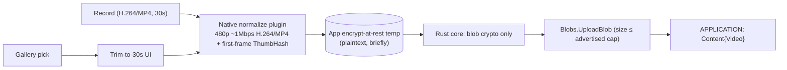

## Context

- **`media-blobs` built the media path** and `audio-messages` is the closest
  sibling: a `Content` body carries a `blob_id`/`blob_key`/size plus type-specific
  fields; the core does the blob crypto, the upload-then-`APPLICATION` send order,
  the cache, ack-delete and 7-day expiry; the server stores opaque ciphertext.
- **`Image` carries a ThumbHash** (`MAX_THUMBHASH_BYTES` = 64) for the blur
  placeholder; video reuses the idea with a first-frame ThumbHash.
- **`ServerInfo.Limits`** already advertises the envelope size limits in the
  `GetServerInfo` handshake; it is the place to add the video size limit.
- **Today's blob cap is compile-time** (`protocol::blob_store::MAX_BLOB_BYTES`,
  image-sized ~2 MB). Video needs a larger, tunable cap.
- **The core owns every media transform today** (client-runtime: Image encode
  pipeline) in pure Rust. There is no viable pure-Rust H.264 hardware transcode on
  mobile, so video breaks this.
- **Owner decisions (2026-11-23):** MP4/H.264+AAC; 480p ~1 Mbps; 30 s config-driven
  cap; record + gallery-with-trim; native-plugin transcode, core crypto only;
  groups and DMs; first-frame ThumbHash in the body; advertise via
  `ServerInfo.Limits`.

## Goals / Non-Goals

**Goals**
- Send and play a ≤ 30 s video, end-to-end encrypted like an image.
- Reuse the blob machinery unchanged; one tunable size limit.
- Record straight to H.264/MP4; normalize gallery clips in a native plugin.

**Non-goals**
- Video calls (see `audio-calls`); multiple clips; filters/editing; a separate
  poster blob; a new `Blobs` RPC.

## Decisions

### D1. The `Video` body mirrors `Image`

- **`Video { bytes blob_id; bytes blob_key; uint64 blob_size; uint32 duration_ms;
  uint32 width; uint32 height; bytes thumbhash; }`**
  - `blob_id`/`blob_key`: as `Image`; the key travels only inside the encrypted
    `Content`.
  - `duration_ms` ≤ `protocol::video::MAX_VIDEO_DURATION_MS` (30 000).
  - `thumbhash`: a ThumbHash of the first frame, ≤ `MAX_THUMBHASH_BYTES`, for the
    blur placeholder (owner, 2026-11-23). No separate poster blob.
- **No container/codec field:** MP4/H.264/AAC is fixed, as WebP is fixed for images.

### D2. Config-driven size limit, within a protocol ceiling (documented departure)

- **`protocol::video`** keeps `MAX_VIDEO_BYTES` (hard ceiling, ~8 MiB) and
  `DEFAULT_MAX_VIDEO_BYTES` (~5 MiB). The server reads `max_video_blob_bytes` from
  its config at startup and **clamps it to `[current image cap, MAX_VIDEO_BYTES]`**;
  an unset or out-of-range value falls back to the default.
- **The server enforces one max blob size** (the clamped config value) on every
  `Blobs.UploadBlob`, because it only sees ciphertext bytes and cannot tell a video
  blob from an image blob. Images stay capped to 2 MB client-side by the image
  pipeline; the server's outer cap is now the video-sized config value.
- **The server advertises the value** in `ServerInfo.Limits.max_video_blob_bytes`.
- **Clients fetch it** and refuse a video whose encrypted blob would exceed it, and
  independently enforce the 30 s **duration** (the server cannot see duration).
- **Why config-driven:** the owner wants to tune the limit without a rebuild;
  `protocol/` still bounds it so config cannot set an unsafe value. This is the
  stated departure from "limits live compile-time in `protocol/`".

### D3. Two sources, normalized in a native plugin (documented bend)

- **Record:** the camera is configured to H.264/MP4 at the 480p/~1 Mbps target,
  overriding the iOS HEVC default, and bounded to 30 s at capture — no transcode
  needed.
- **Gallery:** `image_picker` in video mode. The clip is handed to the **native
  normalize plugin** (AVFoundation / MediaCodec), which transcodes to canonical
  H.264/MP4, downscales the long edge to 854, caps bitrate ~1 Mbps and size to the
  advertised limit, and **trims to ≤ 30 s** — over-limit clips get a trim-to-30 s
  slider UI (WhatsApp-style), not a rejection.
- **The core does crypto only.** It receives the normalized MP4 bytes (and the
  ThumbHash, or computes it), encrypts the blob with a fresh key/`blob_id`, and
  runs the same upload-then-send order as an image. The normalized plaintext lives
  briefly in the app's private, encrypt-at-rest temp (today's image/audio cache
  location) before the core encrypts it, then is removed.
- **Why the bend:** no viable pure-Rust mobile H.264 hardware transcode exists;
  forcing it into the core would mean software transcode (slow, battery) or
  shipping a C/native encoder into the core anyway. The platform plugins use the
  hardware codecs. Stated honestly in `client-runtime` and the arch doc; the
  crypto and keys still never leave the core, and the plaintext never leaves the
  encrypt-at-rest temp unencrypted.

### D4. Reuse the blob machinery; groups and DMs

- Upload, cache, ack-delete, 7-day expiry, resend and the offline queue are exactly
  the image/audio path; a video blob is a blob. No new `Blobs` RPC.
- Video is allowed wherever images are — the lobby, named groups and DMs (owner).

### D5. Playback

- The bubble shows the ThumbHash blur at the video's aspect ratio with a play
  overlay and the duration; the clip downloads on first tap (no auto-download), then
  a full-screen player plays it. One video plays at a time. An expired blob shows
  "Video expired"; the sender can resend from its cache, like an image.

## Spikes (before code that relies on them)

- **S1 (at implementation time):** the native normalize plugin on both iOS
  (AVFoundation) and Android (MediaCodec) produces canonical H.264/MP4 at the target
  within the size cap, including the trim, and hands the core the bytes + ThumbHash;
  confirm the camera can be forced to H.264/MP4 on iOS. Record the result in this
  design.

## Risks / Trade-offs

- **The native-plugin bend** moves a transform out of the core; mitigated by keeping
  all crypto/keys in the core and the plaintext only in the encrypt-at-rest temp.
- **One server-side blob cap for all media** means the server's outer limit rises to
  the video size; images stay small by the client pipeline. Accepted.
- **Config-driven limit** is bounded by the protocol ceiling so a bad config cannot
  set an unsafe value.
- **480p** is deliberately modest to protect the home server's bandwidth; tunable up
  within the ceiling via config.

## Migration Plan

1. Deploy the server with the new config key (default applies if unset) — it begins
   advertising `max_video_blob_bytes` and enforcing the larger blob cap. Old apps
   are unaffected (they send no video and show the placeholder for one).
2. Release the app: record/gallery, the normalize plugin, the bubble and player.

**Rollback:** lower or remove the config key (video sends then fail the size check);
the blob store and other media are unaffected.

## Open Questions (owner)

1. **Audio in gallery clips with no audio track:** send video-only, or require/insert
   a silent AAC track?
2. **Record resolution follow-the-config, or fixed 480p at capture** regardless of
   the server cap?
3. **Mute-by-default playback** (tap to unmute) like some feeds, or play with sound?
