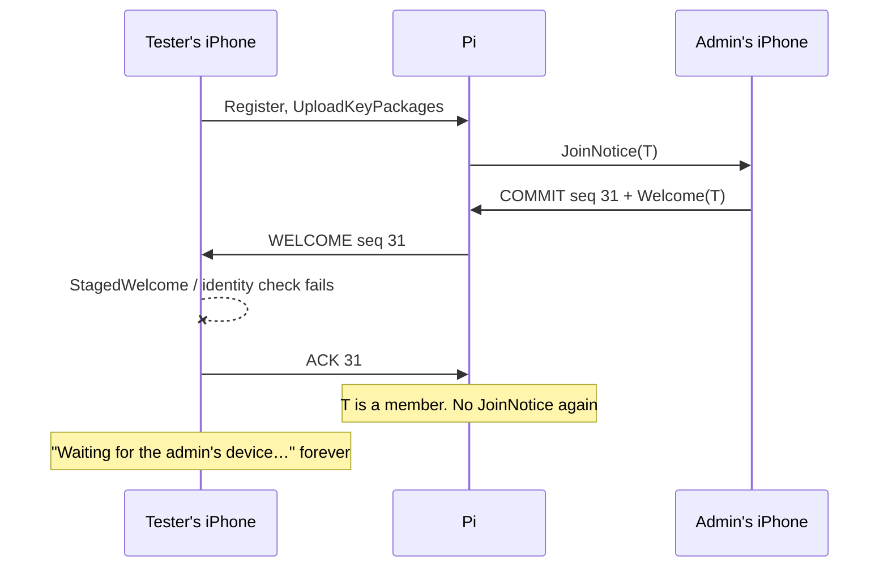

## Context

2026-11-16 (real group, TestFlight 1.0.0 (3)):

| time  | what |
|-------|------|
| 21:24:23 | the tester's iPhone registers |
| 21:24:33 | its 21 KeyPackages reach the Pi → `JoinNotice` to the admin's iPhone |
| 21:24:40 | admin's iPhone commits seq 31 (epoch 3 → 4) with the Welcome |
| 21:24–21:48 | tester reconnects 13 times, acks 31…39, sends nothing |

The core refused the Welcome (both refusal paths log, emit `CommitRefused` and
ACK), the app showed it only in the chat, and the Pi kept counting the device
as a member (`was_member = 1`, in `mls_members`), so no new `JoinNotice` came.



## Goals / Non-Goals

- Goal: the reason is visible on the waiting screen.
- Goal: a device that cannot use its Welcome gets re-added without a wipe, a
  new invite or anyone tapping anything (owner decision, D6).
- Goal: the Pi learns the error text, so the owner can read the cause in the
  Pi's journal without asking the tester.
- Non-goal: fixing the root cause blind. It is not proven yet (D1).

## Decisions

### D1. Cause: not proven yet; ship visibility and recovery first

What was checked (2026-11-16):

| suspect | evidence | verdict |
|---|---|---|
| Entitlements (4a55ba3) | exported IPA: `application-identifier`, `team-identifier`, `aps-environment = production`, no `keychain-access-groups` (default group = app id, as in build 2) | not it |
| Keychain unreadable on device | tester's phone re-authenticated 13 times (auth key from the keychain); storage key is read once at `Store::open` | not it |
| Phone clock (lifetimes) | tester's certificate `created_at` 5.7 s before the Pi's registration time | not it |
| Identity check of a leaf | the admin's Android phone joined at epoch 4 → 5 from a Welcome with the same leaves plus the tester's | unlikely |
| Crypto provider | `openmls_rust_crypto` (portable), no `cfg(target_os)` in storage or MLS code | unlikely |
| Release on a simulator | Flutter has no release mode on iOS simulators | could not run |

Still open: why `StagedWelcome` (or the identity check) failed on that phone.
Only the error text tells. With this change it reaches the Pi's journal
(`RequestReaddRequest.reason`, D3) and the waiting screen (D5). If it is
deterministic on that phone, the re-add fails again (bounded by D4), and the
text is then in hand.

Also checked: two other new members showed no sign of the bug on the Pi
(one had simply not reconnected yet, one had joined; owner, 2026-11-17). Had
either been stuck, D2 covers them the same way, including at the first
start on build 4 (`refused_welcome_seq = 0`).

### D2. The stuck device asks the Pi: `Keys.RequestReadd`

Alternatives:
- (a) Pi detects "never sent anything" → guesses. Wrong for quiet members.
- (b) Admin removes and re-invites → a wipe and a new invite: what we avoid.
- (c) **The device says it is stuck; the Pi checks it** ← chosen.

The core calls it:
- right after refusing a Welcome (`refused_welcome_seq` = that `server_seq`);
- once per engine start when it has an account but no group (`0`): this covers
  devices stuck on an older build, like the tester's.
  Not on admin devices: before the group exists the admin's first device
  creates it (its ask would only cost a round trip at every start), and a
  linked admin device still asks when it refuses its Welcome.

The Pi answers `ASKED` only if all hold, else changes nothing:

| check | else |
|---|---|
| caller is a non-revoked device in `mls_members` | `NOT_A_MEMBER` (normal first-add wait) |
| no `deliveries` row with `welcome = 1` and `server_seq > refused_welcome_seq` | `WELCOME_QUEUED` |
| not already in `inactive_devices` | `ALREADY_WAITING` |
| < `MAX_READD_REQUESTS_PER_DAY` (3) asks in the last 24 h | `LIMIT_REACHED` |

The `server_seq` bound handles the race between the ACK on the stream and the
RPC on its own HTTP/2 stream: the refused Welcome itself never counts.

### D3. On `ASKED`, reuse inactivity + Automatic re-add

One transaction:
1. replace all of the device's KeyPackages with the request's (checked like
   `UploadKeyPackages`). If the refusal came from missing KeyPackage private
   keys, the old ones on the Pi are suspect too.
2. `write::mark_inactive` (drops its queue, issues the Pi's external Remove).
3. `inactivity::mark_returned(now)`; after the commit, record the ask in the
   in-memory limit (D4).
4. log `reason` (error text only, never content) with the device id.

Then send a `RejoinNotice` for the device to connected helpers (`can_readd`:
the user's other devices, the admin's devices). Helpers that connect later get
it from `connect_info` as today. The helper's existing `Readd` job commits
Remove + Add with a fresh KeyPackage. The Pi clears the inactive mark when the
add is accepted, and the Welcome reaches the device on its open stream.

```mermaid
sequenceDiagram
  participant T as Stuck device
  participant P as Pi
  participant A as Admin's device
  T->>P: Keys.RequestReadd(seq, reason, fresh KPs)
  P->>P: checks (D2); replace KPs; mark inactive + returned; log reason
  P-->>T: ASKED
  P->>A: PROPOSAL (Pi Remove of T's leaf), RejoinNotice(T)
  A->>P: FetchKeyPackages(T only)
  A->>A: verify cert vs pinned identity key
  A->>P: COMMIT Remove(old leaf) + Add(T) + Welcome
  P->>T: WELCOME
  T->>T: JoinedGroup
```

A device in no group ignores the `RemovedNotice` the Pi sends it on its next
connect: there is no group or history it was removed from.

### D4. Limits

- Pi: 3 asks per device per sliding 24 h (`protocol::group_membership`),
  counted in memory (`membership::readd::ReaddAsks` in `State`). It only
  stops a commit loop: a Pi restart that forgets it is harmless, and with no
  schema change `deploy.sh --rollback` keeps working.
- Core: one ask per refused Welcome, one per engine start; `LIMIT_REACHED` is
  shown and the core does not retry until its next start.
- Worst case per stuck device: 3 Remove + Add commits a day.

### D5. What the app shows

- Waiting screen: the newest refusal (text + time), and the newest
  `ReaddRequested` outcome, in the owner's words (D6).
- The chat later still has the `CommitRefusedNotice`, so a screenshot shows the
  cause even after a successful re-add.

### D6. Policy (owner decisions, 2026-11-16)

Asked through the tracker; the owner answered in their own words:

| question | owner's answer |
|---|---|
| Re-add | automatic and silent: the admin's device commits Remove + Add from a fresh KeyPackage, no tap |
| Trigger on the stuck device | automatic: right after a refusal, and at start when it has no group but the Pi counts it a member; no button |
| Waiting-screen text | "Your phone couldn't open the admin's invitation to the group. It has asked to be added again; this happens on its own. Reason: <error> (<time>)" |
| Limit | at most 3 automatic asks a day per device, enforced by the Pi; after that it waits for the admin |

The app shows the owner's text, from the newest refusal and the ask's
outcome:
- refused + asked: the text above.
- refused, not asked yet: its first sentence + "Reason: …".
- limit reached: "It has asked to be added again too often today and now
  waits for the admin." instead of the middle sentence.

"Waits for the admin": after the limit the Pi changes nothing more that
day. The admin can remove and re-invite the user, or the device asks again
at a start after the 24-hour window.

### D7. Security reasoning

Who enforces what:

| threat | why it does not work |
|---|---|
| Pi forges membership with `RejoinNotice` | it adds no one: the helper fetches the KeyPackage and verifies its certificate against the user's pinned identity key (client, key-directory), as for every add |
| Pi swaps in its own KeyPackage | same check: the KeyPackage's credential must carry a certificate signed by the user's identity key, and its signature key must equal the certificate's MLS key |
| Pi fakes an ask to kick a device out | the Pi can already do that (inactivity Removes); no new power |
| A device asks for someone else | the caller is the session's device; there is no device id in the request |
| A member loops asks to churn epochs | Pi limit, 3 a day; each costs one commit |
| A removed or revoked device asks to get back in | `NOT_A_MEMBER` (not in the tree), and revoked devices are never re-added (`inactivity::waiting` filters revoked) |
| The reason leaks content | it is the core's error text (OpenMLS / identity-check errors), never plaintext; cut to 512 bytes |

Commit authority is unchanged: the re-add is a Remove + Add by an admin device,
or by the user's own device for its own devices.

### D8. Fresh keys for a new signup (the owner's re-invite failed)

What the owner saw (2026-11-16 22:45-23:02, Pi journal): they removed
the iPhone tester (22:45:10) and made a new invite (22:45:37). The phone
never reached a registration (no "registered a user" line), and the invite
was revoked at 23:02:50.

Why: `register` and `link_request` used `get_or_create` for the device auth,
MLS signature and identity keys. The iOS Keychain keeps items after the app
is deleted, so a reinstalled iPhone reused the revoked device's auth key →
same device id → `Devices.Register` answered `ALREADY_EXISTS`
("this device is already registered"). Android deletes its Keystore entries
and SharedPreferences on uninstall, so it never hit this. The app has no
"join again" path after a removal besides a reinstall.

Fix (client-enforced, device-identity: Fresh keys for a new signup): a
device with no account creates new keys for each signup or link request
(`keystore::create_fresh`), and a link request deletes a leftover identity
key. The storage key is still reused on a fresh database. That is harmless:
the key check is written fresh.

Possible link to D1: leftover Keychain items are the one real difference
found between a fresh iPhone install and every other device. They don't
explain the refused Welcome by themselves (KeyPackage keys were new), but if
the tester had an earlier install, its old identity and device keys were
reused at 21:24. The error text will settle it.

## Risks / Trade-offs

- If the cause is deterministic on that phone, every re-add fails until it is
  fixed. Bounded by D4, and the error text then reaches the Pi's log.
- Messages sent between the first add and the re-add are lost for that device,
  as for any inactive device. A device that never joined had none anyway.
- Old one-time KeyPackage private keys stay in the device's local storage
  (harmless; a later cleanup).

## Migration

- No schema change on the Pi or the core.
- Deploy the Pi before build 4 reaches testers. An old Pi answers
  `UNIMPLEMENTED`; the core then deletes the unused KeyPackages, logs it and
  waits as before.
- KeyPackages the Pi does not take (any answer but `ASKED`) are deleted from
  the device's storage, so asking at every start does not pile them up.
